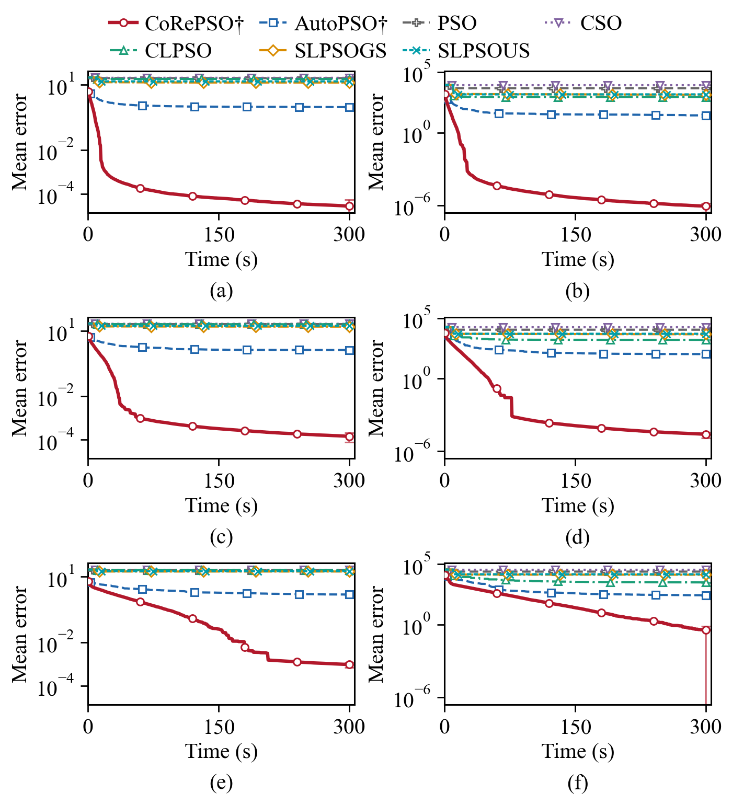

# CoRePSO

**Coupling-Aware Recombination and State Inheritance for Particle Swarm Optimization**

Research implementation and recorded results for CoRePSO. The method combines
coupling-validated local proposals with selective inheritance of swarm states,
using the particle-update representation of [AutoPSO](https://github.com/EMI-Group/AutoPSO).
All population evaluations, local probes and rejected proposals share an explicit
function-evaluation budget.

## Method

CoRePSO alternates population exploration and local search at spatially separated
centers. It compares the observed improvement of a joint coordinate proposal with
the sum of its individual improvements. Weak agreement triggers smaller block
tests; acceptance depends on an actual objective improvement. A curvature-ray
operator supplies complementary directions when its finite-difference probes fit
within the local allowance. Selected lineages carry particle states into the next
round, while a fraction of the population is refreshed.

The implementation retains the settings evaluated in the manuscript: 100 inner
updates per CoRePSO round, local allowance at most one quarter of the preceding
population-search cost, and a per-center cap of 5000 evaluations. AutoPSO uses
800 inner updates per round. See [reproduction details](REPRODUCING.md) for the
function groups, population sizes, clocks and statistical families.

## Installation

Use Python 3.11 or newer and install a PyTorch build appropriate for your machine.
The CPU example requires no CUDA device. The manuscript's accelerated benchmark
runners require CUDA.

```bash
git clone https://github.com/N2308490G/CoRePSO.git
cd CoRePSO
python -m venv .venv
```

Activate with `.venv\Scripts\activate` on Windows or
`source .venv/bin/activate` on Linux/macOS, then:

```bash
python -m pip install -e .
python scripts/fetch_dependencies.py autopso
python examples/minimize.py
```

The upstream AutoPSO core is fetched at a fixed commit and verified against its
recorded Git blob. It is not bundled here; see [third-party sources](THIRD_PARTY.md).
Run examples and archived benchmark commands from the repository root.

## Quick start

```python
import torch
from corepso import minimize

torch.set_num_threads(1)

def objective(x):
    # x: (batch, dimension), float64, in physical coordinates.
    return ((x - x.new_tensor([0.3, -0.8, 1.2])) ** 2).sum(dim=-1)

result = minimize(
    objective,
    lower=[-3.0, -3.0, -3.0],
    upper=[4.0, 4.0, 4.0],
    max_fes=8000,
    seed=42,
    lineages=4,
    particles=8,
    device="cpu",
)
print(result.x, result.fun, result.nfev)
```

The convenience interface evaluates eagerly; the archived CUDA runners implement
the paper's graph execution. This small example demonstrates usage, not a result
from the study. CoRePSO itself needs no trained checkpoint.

## Recorded results

The numerical study contains 54 fixed cases, with 11 optimization repetitions per
case and method. Errors below `1e-8` are scored as zero. Mean ties use
`1e-8 + 1e-9 * max(abs(mean_a), abs(mean_b))`.

| Comparison against AutoPSO | Lower mean | Tied mean | Higher mean |
|---|---:|---:|---:|
| Equal function-evaluation budgets | 45 | 5 | 4 |
| Recorded time budgets | 33 | 8 | 13 |

The lower mean errors are concentrated in canonical and unrotated
high-dimensional functions. All adjusted probabilities in the primary 54-case
Holm families exceed 0.05. Under recorded time budgets, AutoPSO has lower means on
four shifted/rotated cases. The two solver groups have different graph-preparation
clock conventions, documented in [REPRODUCING.md](REPRODUCING.md).

<p align="center">
  
</p>

*All six unrotated high-dimensional cases: Ackley and Rastrigin at 500, 1000 and
2000 dimensions. Curves average 11 runs under the recorded 300-second protocol;
the complete 54-case curve data are included in `results/recorded_time_curves.json.gz`.*

The complete learned comparison uses five final 100-epoch checkpoints on 12 fixed
CEC-derived 20D functions, with 11 repetitions and a cap of 24,800,000 evaluations.
The following counts use one joint, post-hoc Holm family of 72 two-sided tests,
including AutoPSO. `N` means non-rejection, not equivalence.

| Comparator | Significant CoRePSO wins | N | Significant CoRePSO losses |
|---|---:|---:|---:|
| AutoPSO | 7 | 5 | 0 |
| DEDQN | 8 | 4 | 0 |
| SYMBOL | 12 | 0 | 0 |
| GLEET | 11 | 1 | 0 |
| RLHPSDE | 6 | 6 | 0 |
| RLEPSO | 11 | 1 | 0 |

DEDQN and RLHPSDE have lower means on F3, RLHPSDE on F8, and AutoPSO on F12;
these comparisons remain unrejected. Learned comparators use independent
Mann–Whitney tests, while AutoPSO uses paired Wilcoxon tests. The complete
72-row probability table is in [results/learned_significance.csv](results/learned_significance.csv).

The engineering evaluation has 297 runs across FM-6D, Radar-19D and Radar-20D.
CLPSO, the no-inheritance control and SLPSOUS, respectively, have the lowest
means on these three instances. CoRePSO does not attain the lowest mean on any of
them; its comparisons with AutoPSO are unrejected after the three-instance Holm
correction. These are deterministic, noise-free design/fit instances. Radar uses
both signed branches of the CEC2011 technical-report objective.

The numerical families were available during development; repetitions measure
optimizer variability on fixed instances. They do not establish performance on
unseen application distributions. The learned records span two GPU models, so
their elapsed times are not a homogeneous-hardware speed comparison.

## Inspect results without running experiments

```bash
python scripts/summarize_results.py
```

This command checks the 660 learned records and 264 reused CoRePSO/AutoPSO
endpoints, recomputes all 72 comparisons, and verifies them against the manuscript
CSV. It does not invoke optimization or training.

```bash
python -m unittest discover -s tests -v
```

The tests exercise the small CPU interface, budget accounting, bounds and invalid
objective handling. Formal benchmark runs are separate commands described in
[REPRODUCING.md](REPRODUCING.md).

## Repository layout

```text
src/                         Core controller, local operators and archived runners
examples/minimize.py          Small CPU example
scripts/fetch_dependencies.py Pinned third-party fetchers
scripts/summarize_results.py  Table III reproduction from saved observations
configs/                     Retained study plans and fixed parameter grids
results/                     Compact observations, aggregate curves and table CSVs
new_shiftrot_instances/       Six fixed generated shift/rotation instances
patches/                     Recorded MetaBox accounting/boundary corrections
tests/                       Focused interface checks
assets/                      Manuscript convergence figure
```

The release includes compact observations and aggregate trajectories, rather than
the multi-gigabyte original execution traces. The five learned checkpoint binaries
are not included. Their training/evaluation source and plans are provided;
the saved observations suffice to reproduce the reported Table III statistics.
[Results documentation](results/README.md) identifies the contents of each file.

## Acknowledgements and reference implementation

The particle-update implementation is from
[AutoPSO](https://github.com/EMI-Group/AutoPSO). Traditional and learned baselines
use [EvoX](https://github.com/EMI-Group/evox) and
[MetaBox](https://github.com/MetaEvo/MetaBox), respectively. Benchmark definitions
come from the CEC resources listed in [THIRD_PARTY.md](THIRD_PARTY.md).
Dependency revisions, the retained CEC-derived definition and the MetaBox patch
are recorded explicitly.
